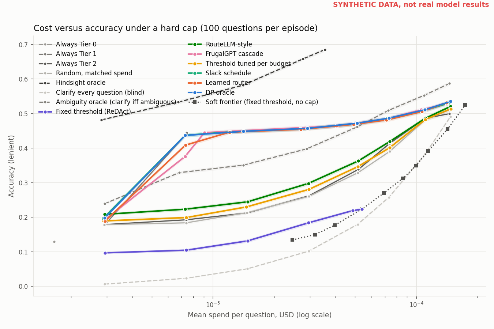

# Budget Guard

A router that decides, question by question, whether to answer with a cheap model, escalate to a stronger one, or ask the user a clarifying question, while never spending more than a hard dollar cap over a stream of questions.

The results below are on SYNTHETIC data. The pipeline, policies and tests are real, but the real model answers haven't been collected yet. RUNBOOK.md has the steps, and the real run costs under $4.

## Why this exists

Most routing and cascade work treats cost as something to minimize on average. Production systems usually have a cap instead: a per-request ceiling, a per-batch budget, a monthly limit that must not be crossed. A router that's right on average can still blow through the cap on a bad run of hard questions.

This project extends my SIT320 research proposal (in `research/poc`). There, in a toy model, a policy that conditions on remaining budget, solved exactly by dynamic programming, beat a ReDAct-style fixed uncertainty threshold under a hard per-task cap, with zero violations. Budget Guard takes that idea to real questions, real model tiers and real prices, using AmbigNQ, where about half the questions are ambiguous, so asking the user is sometimes the right move.

## How it works

Three tiers answer every question once, and the answers are cached:

| Tier | Model | Price per 1M tokens (in / out) |
|---|---|---|
| 0 | Qwen3-4B-Instruct on Kaggle | free, modelled at 0.02 / 0.08, swept over 0, 0.02/0.08 and 0.05/0.20 |
| 1 | gpt-6-luna, reasoning effort none | 0.10 / 0.50 |
| 2 | gpt-6-sol, reasoning effort none | 2.00 / 10.00 |

An episode is a stream of K = 100 questions with a hard budget B. For each question a policy can probe Tier 0 (pay for it and see its confidence), answer with any tier, clarify (pay a fee, then a tier answers the intended reading), or skip. Before any action the runner computes its worst-case cost (input tokens times input price plus max output tokens times output price, plus the fee) and masks it if that would break the cap. Then it charges the actual cost from the cache. Actual is always at most the worst case, so a masked policy can't go over budget. The tests check this for every policy at every budget, fee and price.

Policies compared:

- Always Tier 0, 1 or 2, the floors and ceilings
- Random at matched spend, the signal-blind control
- Fixed threshold, calibrated once (the ReDAct reference)
- Threshold tuned per budget
- FrugalGPT-style confidence cascade with a clarify gate
- RouteLLM-style router, question embedding plus logistic regression, no probe
- Exact DP over (questions left, budget left, signal bin), the proposal's oracle with additive reward
- Slack threshold schedule fitted to the DP, the proposal's interpretable method
- Learned router, behaviour cloned from the DP, with remaining budget per remaining question as an input
- Hindsight oracle, which knows every answer, as the upper bound
- Two clarify references built on the same DP: clarify every question (blind), and an ambiguity oracle that clarifies exactly when the question is ambiguous

The DP and the learned router also get a free ambiguity score from the question text alone (hand features plus a sentence embedding, fitted on calib), which they can use before paying for any call.

Everything is fitted on calib, tuned on tune, and the test split is only read in the final evaluate step. Every entry point verifies the frozen split hashes first and asserts that no test question reaches fitting data. DECISIONS.md logs every choice along the way.

## Results (SYNTHETIC)



The synthetic world is calibrated to the real 300-question pilot: per-tier accuracy on clear, raw ambiguous and clarified questions, confidence AUROC around 0.7, ambiguity invisible to model signals, and a text detector near 0.65. Accuracy (lenient match, pre-registered) on the synthetic test split, 300 episodes of 100 questions over three stream seeds, clarify fee equal to one mean Tier 2 call, Tier 0 at 0.02/0.08. Budget is per question in u2, the mean Tier 2 call cost. Brackets are bootstrap 95 percent CIs over episodes. Violation rate is 0 in every row. Experiment design sha256 637c0563...27e5 (frozen).

| Policy | budget 0.02 u2 | budget 0.35 u2 | budget 1 u2 |
|---|---|---|---|
| Always Tier 0 | 0.129 (0.125 to 0.133) | 0.129 (0.125 to 0.133) | 0.129 (0.125 to 0.133) |
| Always Tier 1 | 0.179 (0.176 to 0.182) | 0.445 (0.439 to 0.451) | 0.445 (0.439 to 0.451) |
| Always Tier 2 | 0.179 (0.176 to 0.182) | 0.338 (0.333 to 0.344) | 0.500 (0.494 to 0.505) |
| Random, matched spend | 0.178 (0.174 to 0.182) | 0.329 (0.323 to 0.334) | 0.512 (0.506 to 0.518) |
| Fixed threshold (ReDAct) | 0.097 (0.094 to 0.100) | 0.219 (0.215 to 0.224) | 0.223 (0.219 to 0.228) |
| Threshold tuned per budget | 0.189 (0.185 to 0.193) | 0.346 (0.341 to 0.352) | 0.514 (0.508 to 0.520) |
| FrugalGPT cascade | 0.189 (0.185 to 0.193) | 0.464 (0.458 to 0.470) | 0.528 (0.523 to 0.534) |
| RouteLLM-style | 0.208 (0.205 to 0.212) | 0.363 (0.357 to 0.368) | 0.521 (0.515 to 0.526) |
| Slack schedule | 0.197 (0.192 to 0.201) | 0.469 (0.463 to 0.475) | 0.531 (0.525 to 0.536) |
| Learned router | 0.189 (0.185 to 0.193) | 0.469 (0.463 to 0.474) | 0.531 (0.526 to 0.537) |
| DP oracle | 0.198 (0.194 to 0.202) | 0.472 (0.466 to 0.478) | 0.535 (0.530 to 0.541) |
| Clarify every question (blind) | 0.006 (0.006 to 0.007) | 0.179 (0.176 to 0.183) | 0.491 (0.486 to 0.497) |
| Ambiguity oracle (clarify iff ambiguous) | 0.239 (0.235 to 0.243) | 0.461 (0.455 to 0.467) | 0.587 (0.581 to 0.592) |
| Hindsight oracle | 0.482 (0.478 to 0.486) | 0.685 (0.679 to 0.690) | 0.685 (0.679 to 0.691) |

What the synthetic run says, for what it's worth before real data:

- Against a fair baseline, budget-awareness buys about a point. The strongest simple policy that can use Tier 1 (always Tier 1 at tight budgets, the FrugalGPT cascade from 0.35 u2 up) is within 1 point of the DP at every budget: the DP is 0.8 points ahead at 0.35 u2 and 0.7 at 1 u2. The learned router and the slack schedule track the DP within about a point. This is the honest headline for now.
- Against the ReDAct-style thresholds the gap looks huge (the DP beats the tuned threshold by 12.6 points at 0.35 u2, paired CI 12.1 to 13.1), but most of that is not budget-awareness. The threshold rules are two-model (Tier 0 or Tier 2), and on the pilot Tier 1 is nearly as good as Tier 2 at a twentieth of the price while Tier 0 is weak. Plain always Tier 1 beats the tuned threshold at every budget below 0.75 u2.
- The toy's failure modes still show. The fixed threshold runs dry at tight budgets (0.097 at 0.02 u2, below always Tier 0's 0.129) and can't use money at loose ones (stuck at 0.223).
- The guard matters. Run without masking, the fixed and tuned thresholds go over the cap in 100 percent of episodes at budgets up to 0.2 u2, with p95 spend up to 23 times the budget.
- Clarifying is hard to aim. With ambiguity nearly invisible to the model signals, the DP clarifies 15 percent of questions at 0.35 u2 with 56 percent precision and 19 percent recall. Clarifying exactly the ambiguous questions is worth 5 points over the DP at 1 u2, but it is worse than the DP at middle budgets, where forcing a clarify on every ambiguous question costs more than it returns.
- The free text ambiguity score doesn't earn its place in the DP here. Under the frozen rule (more text bins only if they win by 0.5 points on tune) every config kept a single bin.

Other figures in `results/figures`: accuracy by budget, violations and p95 spend without the guard, the clarify fee and Tier 0 price sweeps, and Tier 2 use by remaining slack. Full numbers are in `results/summary.csv` and `results/paired.csv`.

## Reproduce for $0

Python 3.11 or newer, 8 GB RAM, no GPU.

```
pip install -r requirements.txt
python scripts/bg.py test          # offline test suite, about 30 seconds
python scripts/bg.py synthetic     # synthetic world, grading, features, full evaluation, about 4 minutes
```

Once the real cache is in `data/cache`, rebuilding every number and figure from it costs nothing and needs no network:

```
python scripts/bg.py real          # grade, features, evaluate on data/, writes results/
```

Each stage also runs alone (`synth`, `grade`, `features`, `evaluate`, `report`). `python scripts/bg.py --help` lists them, and there's a Makefile wrapper if you have make.

## Real run cost

Worst case, using the same formula `cache_api` enforces (estimated input tokens, every answer at the 24-token max), scaled to AmbigNQ's roughly 12,000 questions and 17,700 prompts:

| Step | Pricing | Worst case |
|---|---|---|
| Pilot, 300 questions (about 450 prompts), Tier 1 and 2 | standard (sync) | about $0.18 |
| Full run, every prompt, Tier 1 and 2 | batch, 50 percent off | about $3.45 more |
| Tier 0 on Kaggle | free GPU | $0 |

So the pilot stays under $0.20 and everything together under $4, before any answer comes in short. `cache_api estimate` prints the exact figure once the real splits exist, and every paid command refuses to run past its cap. RUNBOOK.md walks through it.

## Layout

```
src/budget_guard/
  split.py        frozen calib, tune, test and pilot splits from AmbigNQ, plus prompts.jsonl
  cache_api.py    resumable, budget-guarded API cache, sync and Batch modes
  prompts.py      the one prompt every tier uses
  grade.py        SQuAD normalization, EM, token F1, lenient match
  synthetic.py    synthetic splits and caches through the real code paths
  features.py     per-pid feature table and cached question embeddings
  signals.py      calibrated Tier 0 confidence and ambiguity belief, fitted on calib
  episodes.py     environment, stream sampler, hard-cap runner
  policies/       every routing policy
  evaluate.py     sweeps, bootstrap CIs, paired differences
  report.py       figures and the results table
notebooks/kaggle_tier0.py   Tier 0 on a Kaggle T4, checkpointed and resumable
scripts/bg.py               one command per stage
tests/                      offline pytest suite
research/poc/               the SIT320 proposal, comparison note and toy notebook
```

## Limitations

- These numbers are synthetic. The generator is calibrated to the real pilot (accuracy per tier and question type, confidence AUROC, how often Tier 1 and Tier 2 agree, and how invisible ambiguity is), so it is a realistic rehearsal, but its structure is still my modelling choice. Treat it as a test that the machinery works and a forecast to check, not a finding.
- This is a reframing of the SIT320 formulation, not the formulation itself. The proposal is about multi-step tool-using agents, where one failed step ends the task, the reward is a product over steps, and clarifying helps every remaining step. Here each question is single-turn, the reward is the number correct over a stream (additive), and a clarification only helps the question it was asked on. The remaining budget plays the same role in the state, and the DP, the monotonicity lemma and the hard cap carry over, but the dependence between steps, which is what made the toy interesting, is gone. Irreversible actions and the post-hoc abstention failure mode aren't tested at all.
- That reframing puts this close to TREACLE, which also learns a budget-constrained policy over a stream of independent questions with remaining budget in the state. The differences are the clarify action priced against escalation, the hard per-episode cap enforced by worst-case masking rather than an average, and the exact DP and slack-schedule baselines from the proposal. That's a modest step from TREACLE, not a new problem. The multi-step agent setting from the proposal is still the open part.
- Detecting ambiguity is the weak link on real data. On the 300-question pilot, Tier 0 self consistency and cross-tier agreement carry no ambiguity signal (AUROC about 0.5), and the free text detector reaches 0.65 on real tune. An optional paid probe (Tier 1 asked whether the question is ambiguous) is wired up for the pilot only, with a keep rule set before it runs.
- The DP is exact for its own model (Tier 0 signal in 24 bins, mean costs), not for the world. Because Tier 0 says almost nothing about the paid tiers, the DP's information is thin, which is why the FrugalGPT cascade (which sees Tier 1's confidence) and plain always Tier 1 come within about a point of it.
- The learned router is behaviour cloning only. The PPO-Lagrangian fine-tune from the proposal isn't implemented, and with masking already enforcing the cap it would only change how well the router spends, not whether it obeys the cap.
- Clarification is simulated as a perfect user. The answer to a clarifying question is always the hash-chosen intended reading, at a fixed fee. Real users are slower, sometimes vague, and the fee is a modelling choice, which is why it's swept.
- Unlike the toy, the hard-cap DP doesn't sit below a soft frontier here. The soft frontier is the two-tier fixed threshold with no cap, which is a weaker rule than the three-tier DP, so the toy's "price of the guarantee" can't be read off this figure. A fair version would need an uncapped DP, which isn't built yet.
- Tier 0's price is a modelling choice since Kaggle is free. The sweep shows how much it matters. Evaluation uses standard API prices, because a live router can't wait for batch results.
- One sample per tier at temperature 0, on one dataset, one prompt. The lenient metric was pre-registered, and EM is the robustness check (`--metric em`).
- The RouteLLM-style baseline uses a hashing embedding by default so it runs offline. Pass `--embed minilm` for MiniLM, which downloads the model once.
