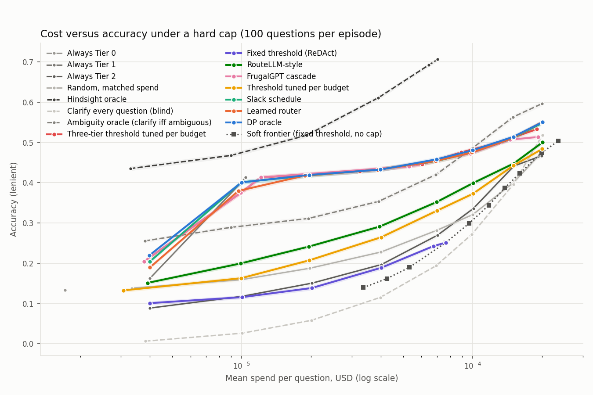

# Budget Guard

A router that decides, question by question, whether to answer with a cheap model, escalate to a stronger one, or ask the user a clarifying question, while never spending more than a hard dollar cap over a stream of questions.

The results below are real: Tier 0 on Kaggle, Tier 1 and Tier 2 from the OpenAI API, answers cached once and every number rebuilt from the cache for $0. The test split was evaluated in two pre-registered passes on 2026-10-20: the lenient headline first, then the EM robustness run. The first pass ran with the code and experiment design frozen beforehand (code commit a6175ad, tag pre-test-eval, design sha256 637c0563...27e5). The EM pass ran from the next commit that touched the repo, 8aa7dca, and no code changed between the two (that commit only adds the lenient results and docs, and `git diff` over `src`, `scripts`, `configs`, `tests` and `notebooks` is empty). Both hashes are the ones after the history was rewritten to fix the author identity and remove some files, and DECISIONS.md 118 to 121 maps them from the old ones (a6175ad was e67c5e9 and 8aa7dca was c0b4fa5). The whole real run cost $1.97.

## Why this exists

Most routing and cascade work treats cost as something to minimize on average. Production systems usually have a cap instead: a per-request ceiling, a per-batch budget, a monthly limit that must not be crossed. A router that's right on average can still blow through the cap on a bad run of hard questions.

This project extends my SIT320 research proposal (summarized in `research/poc/README.md`, the proposal itself isn't in this repo). There, in a toy model, a policy that conditions on remaining budget, solved exactly by dynamic programming, beat a ReDAct-style fixed uncertainty threshold under a hard per-task cap, with zero violations. Budget Guard takes that idea to real questions, real model tiers and real prices, using AmbigNQ, where about half the questions are ambiguous, so asking the user is sometimes the right move.

## How it works

Three tiers answer every question once, and the answers are cached:

| Tier | Model | Price per 1M tokens (in / out) |
|---|---|---|
| 0 | Qwen3-4B-Instruct on Kaggle | free, modelled at 0.02 / 0.08, swept over 0, 0.02/0.08 and 0.05/0.20 |
| 1 | gpt-6-luna, reasoning effort none | 0.10 / 0.50 |
| 2 | gpt-6-sol, reasoning effort none | 2.00 / 10.00 |

An episode is a stream of K = 100 questions with a hard budget B. For each question a policy can probe Tier 0 (pay for it and see its confidence), answer with any tier, clarify (pay a fee, then a tier answers the intended reading), or skip. Before any action the runner computes its worst-case cost (input tokens times input price plus max output tokens times output price, plus the fee) and masks it if that would break the cap. Then it charges the actual cost from the cache. Actual is always at most the worst case, so a masked policy can't go over budget. The tests check this for every policy at every budget, fee and price.

Policies compared:

- Always Tier 0, 1 or 2, the floors and ceilings
- Random at matched spend, the signal-blind control
- Fixed threshold, calibrated once (the ReDAct reference)
- Threshold tuned per budget (two tiers, Tier 0 or Tier 2, the pre-registered ReDAct-style reference)
- Three-tier threshold tuned per budget (Tier 0, 1 or 2 by the same confidence signal)
- FrugalGPT-style confidence cascade with a clarify gate
- RouteLLM-style router, question embedding plus logistic regression, no probe
- Exact DP over (questions left, budget left, signal bin), the proposal's oracle with additive reward
- Slack threshold schedule fitted to the DP, the proposal's interpretable method
- Learned router, behaviour cloned from the DP, with remaining budget per remaining question as an input
- Hindsight oracle, which knows every answer, as the upper bound
- Two clarify references built on the same DP: clarify every question (blind), and an ambiguity oracle that clarifies exactly when the question is ambiguous

The DP and the learned router also get a free ambiguity score from the question text alone (hand features plus a sentence embedding, fitted on calib), which they can use before paying for any call.

Everything is fitted on calib, tuned on tune, and the test split is only read in the final evaluate step. Every entry point verifies the frozen split hashes first and asserts that no test question reaches fitting data. DECISIONS.md logs every choice along the way.

## Results (real data, test split)



Accuracy (lenient match, pre-registered) on the 2,002 test questions, 300 episodes of 100 questions over three stream seeds, clarify fee equal to one mean Tier 2 call, Tier 0 at 0.02/0.08. Budget is per question in u2, the mean Tier 2 call cost (about $0.0002). Brackets are bootstrap 95 percent CIs over episodes. Violation rate is 0 in every row.

| Policy | budget 0.02 u2 | budget 0.35 u2 | budget 1 u2 |
|---|---|---|---|
| Always Tier 0 | 0.133 (0.129 to 0.136) | 0.133 (0.129 to 0.136) | 0.133 (0.129 to 0.136) |
| Always Tier 1 | 0.163 (0.159 to 0.166) | 0.413 (0.408 to 0.419) | 0.413 (0.408 to 0.419) |
| Always Tier 2 | 0.089 (0.086 to 0.092) | 0.270 (0.265 to 0.275) | 0.467 (0.462 to 0.472) |
| Random, matched spend | 0.138 (0.134 to 0.142) | 0.282 (0.277 to 0.287) | 0.477 (0.472 to 0.482) |
| Fixed threshold (ReDAct) | 0.101 (0.096 to 0.106) | 0.243 (0.238 to 0.247) | 0.251 (0.247 to 0.256) |
| Threshold tuned per budget | 0.133 (0.128 to 0.137) | 0.331 (0.326 to 0.336) | 0.484 (0.479 to 0.489) |
| Three-tier threshold tuned per budget | 0.205 (0.200 to 0.209) | 0.446 (0.440 to 0.452) | 0.533 (0.528 to 0.538) |
| FrugalGPT cascade | 0.205 (0.200 to 0.209) | 0.441 (0.435 to 0.446) | 0.514 (0.509 to 0.519) |
| RouteLLM-style | 0.151 (0.147 to 0.156) | 0.352 (0.347 to 0.357) | 0.501 (0.496 to 0.506) |
| Slack schedule | 0.204 (0.199 to 0.208) | 0.454 (0.448 to 0.459) | 0.549 (0.543 to 0.554) |
| Learned router | 0.190 (0.185 to 0.194) | 0.454 (0.448 to 0.460) | 0.551 (0.545 to 0.557) |
| DP oracle | 0.219 (0.215 to 0.224) | 0.458 (0.453 to 0.464) | 0.551 (0.545 to 0.556) |
| Clarify every question (blind) | 0.006 (0.006 to 0.007) | 0.194 (0.191 to 0.197) | 0.518 (0.513 to 0.524) |
| Ambiguity oracle (clarify iff ambiguous) | 0.256 (0.251 to 0.260) | 0.420 (0.414 to 0.426) | 0.597 (0.591 to 0.603) |
| Hindsight oracle | 0.435 (0.430 to 0.441) | 0.693 (0.688 to 0.698) | 0.707 (0.701 to 0.712) |
| Best simple with Tier 1, picked on tune | 0.205 (0.200 to 0.209), FrugalGPT cascade | 0.446 (0.440 to 0.452), Three-tier threshold tuned per budget | 0.533 (0.528 to 0.538), Three-tier threshold tuned per budget |

DP minus each reference, accuracy points, paired bootstrap 95 percent CI over the same episodes.

| DP against | budget 0.02 u2 | budget 0.35 u2 | budget 1 u2 |
|---|---|---|---|
| Fixed two-tier threshold (pre-registered reference) | +11.9 (+11.4 to +12.4) | +21.6 (+20.9 to +22.1) | +29.9 (+29.3 to +30.5) |
| Three-tier threshold tuned per budget | +1.5 (+1.2 to +1.7) | +1.2 (+0.9 to +1.5) | +1.8 (+1.4 to +2.1) |
| Best simple with Tier 1, picked on tune | +1.5 (+1.2 to +1.7) | +1.2 (+0.9 to +1.5) | +1.8 (+1.4 to +2.1) |

What the real run says:

- Budget-awareness buys about one to two points over the strongest baseline that can use Tier 1. The DP beats the three-tier threshold by 0.4 to 2.6 points at every budget (CIs all exclude zero). Against the best simple Tier 1 policy, picked per budget on tune, it's ahead by 0.4 to 1.8 points at seven of the eight budgets and level at 0.05 u2, where always Tier 1 was picked (-0.1, CI -0.2 to +0.0). This is the honest headline.
- Against the pre-registered two-tier ReDAct-style reference the gap looks enormous (+11.9 to +29.9 points over the fixed threshold, +6.6 to +23.8 over the one tuned per budget), but most of that isn't budget-awareness. A two-tier rule only picks Tier 0 or Tier 2, and Tier 1 is nearly as accurate as Tier 2 at a twentieth of the price. The same rule with a Tier 1 step, which is the three-tier threshold, closes almost all of the gap. Both are reported, and the two-tier one stays the pre-registered comparison.
- The fixed threshold fails in both directions, as in the toy. At 0.02 u2 it spends early and runs dry (0.101, below always Tier 0's 0.133), and from 0.5 u2 up it can't use more money (stuck at 0.251).
- The guard matters. Run without masking, always Tier 2, the fixed and tuned two-tier thresholds, RouteLLM and the random control all break the cap in at least 94 percent of episodes at every budget up to 0.2 u2, with p95 spend up to 24 times the budget for the fixed threshold and 52 times for always Tier 2.
- The routers track the DP. The learned router and the slack schedule are within 0.6 points of it from 0.1 u2 up. At the two tightest budgets the learned router trails by 2.9 and 2.1 points and the slack schedule matches it from 0.05 u2.
- Clarifying scales with the budget and is imprecise. The DP clarifies 4 percent of questions at 0.1 u2, 24 percent at 0.35 and 70 percent at 1.0, with precision of 60 to 71 percent against a 47 percent base rate of ambiguous questions. Perfect ambiguity knowledge only pays at large budgets: the ambiguity oracle is ahead by 4.9 points at 0.75 u2 and 4.6 at 1.0, and behind the DP at 0.35 u2 and below, where forcing a clarify on every ambiguous question costs more than it returns.
- Tier 0 is a weak answerer (0.133 accuracy) and a weak probe. On the pilot, no confident slice of its answers matched Tier 1, and its confidence said almost nothing about whether the paid tiers were right.
- The conclusions hold across the sweeps. At 0.35 u2 the DP's lead over the three-tier threshold stays between 1.0 and 1.5 points for clarify fees of 0.5x, 1x and 2x and for all three Tier 0 prices. A cheaper clarify fee lifts every policy that clarifies (the DP goes from 0.443 at 2x to 0.498 at 0.5x).
- The lenient against lenient_plus ranking check flipped five adjacent pairs at three budgets (0.2, 0.5 and 0.75 u2), all between policies within a fraction of a point of each other, so no conclusion changes.
- The pre-registered EM robustness run, a stricter metric, with every policy retuned on it (`results/final_em`), tells the same story. The DP is ahead of the best simple Tier 1 policy by 0.6 to 2.3 points at six of the eight budgets, and level at 0.05 u2 (-0.1, CI -0.3 to +0.1) and 0.75 u2 (+0.2, CI -0.1 to +0.6). Absolute accuracies are about 7 to 8 points lower from 0.05 u2 up. EM reshuffles the middle of the ranking, where many policies sit within a point of each other, but the same group leads and the same group trails (at 0.35 u2 the two-tier thresholds and always Tier 0 and Tier 2 are at the bottom). The learned router comes out within 0.7 points of the DP and slightly ahead of it from 0.35 u2 up, which I read as a tie.

Other figures in `results/final/figures`: accuracy by budget, violations and p95 spend without the guard, the clarify fee and Tier 0 price sweeps, and Tier 2 use by remaining slack. Full numbers are in `results/final/summary.csv`, `paired.csv` and `clarify_reference.csv`, and the decisions of four policies at 0.35 u2 are in `results/final/decisions_*.parquet`. The synthetic rehearsal, which the real pilot was used to calibrate, is kept in `results/synthetic` as a check that the machinery works and isn't a result.

## Reproduce for $0

Python 3.11 or newer, 8 GB RAM, no GPU.

```
pip install -r requirements.txt
python scripts/bg.py test          # offline test suite, about 30 seconds
python scripts/bg.py synthetic     # synthetic world, grading, features, full evaluation, about 4 minutes
```

Once the real cache is in `data/cache`, rebuilding every number and figure from it costs nothing and needs no network:

```
python scripts/bg.py real --minilm   # grade, features, evaluate on data/, writes results/final/ (must not exist yet)
```

Each stage also runs alone (`synth`, `grade`, `features`, `evaluate`, `report`). `python scripts/bg.py --help` lists them, and there's a Makefile wrapper if you have make.

## Real run cost

Worst case, using the same formula `cache_api` enforces (estimated input tokens, every answer at the 24-token max), scaled to AmbigNQ's roughly 12,000 questions and 17,700 prompts:

| Step | Pricing | Worst case |
|---|---|---|
| Pilot, 300 questions (about 450 prompts), Tier 1 and 2 | standard (sync) | about $0.18 |
| Full run, every prompt, Tier 1 and 2 | batch, 50 percent off | about $3.45 more |
| Tier 0 on Kaggle | free GPU | $0 |

The real run came in well under that: $1.97 in total ($0.09 for the pilot, $0.003 for the ambiguity probe and $1.88 for the batches). The worst case is higher because it assumes every answer hits the 24-token maximum. So the pilot stayed under $0.20 and everything together under $4, before any answer came in short. `cache_api estimate` prints the exact figure once the real splits exist, and every paid command refuses to run past its cap. RUNBOOK.md walks through it.

## Layout

```
src/budget_guard/
  split.py        frozen calib, tune, test and pilot splits from AmbigNQ, plus prompts.jsonl
  cache_api.py    resumable, budget-guarded API cache, sync and Batch modes
  prompts.py      the one prompt every tier uses
  grade.py        SQuAD normalization, EM, token F1, lenient match
  synthetic.py    synthetic splits and caches through the real code paths
  features.py     per-pid feature table and cached question embeddings
  signals.py      calibrated Tier 0 confidence and ambiguity belief, fitted on calib
  episodes.py     environment, stream sampler, hard-cap runner
  policies/       every routing policy
  evaluate.py     sweeps, bootstrap CIs, paired differences
  report.py       figures and the results table
notebooks/kaggle_tier0.py   Tier 0 on a Kaggle T4, checkpointed and resumable
scripts/bg.py               one command per stage
tests/                      offline pytest suite
research/poc/README.md      short summary of the SIT320 toy result
LICENSE, DATA_LICENSE.md    MIT for the code, CC BY-SA 3.0 for the AmbigNQ-derived data
```

## License and data

The code is MIT licensed, see `LICENSE`. The questions, gold answers and interpretations come from AmbigNQ (Min et al., 2020), which is CC BY-SA 3.0, and everything built directly from them is shared under the same terms, not MIT. `DATA_LICENSE.md` has the attribution, what in the repo is derived from it, and the model terms.

## Limitations

- The test split was evaluated once, from a frozen commit and design. An earlier accidental start of that evaluation was interrupted, its partial outputs were removed and the guard that now prevents it was added (DECISIONS.md 101 to 111), so no number here comes from that run.
- This is a reframing of the SIT320 formulation, not the formulation itself. The proposal is about multi-step tool-using agents, where one failed step ends the task, the reward is a product over steps, and clarifying helps every remaining step. Here each question is single-turn, the reward is the number correct over a stream (additive), and a clarification only helps the question it was asked on. The remaining budget plays the same role in the state, and the DP, the monotonicity lemma and the hard cap carry over, but the dependence between steps, which is what made the toy interesting, is gone. Irreversible actions and the post-hoc abstention failure mode aren't tested at all.
- That reframing puts this close to TREACLE, which also learns a budget-constrained policy over a stream of independent questions with remaining budget in the state. The differences are the clarify action priced against escalation, the hard per-episode cap enforced by worst-case masking rather than an average, and the exact DP and slack-schedule baselines from the proposal. That's a modest step from TREACLE, not a new problem. The multi-step agent setting from the proposal is still the open part.
- Detecting ambiguity is the weak link. Tier 0 self consistency and cross-tier agreement carry no ambiguity signal on the pilot (AUROC about 0.5), and the free question-text detector reaches 0.65 on tune and 0.68 on test. A paid probe (Tier 1 asked whether the question is ambiguous) was tried on the pilot against a rule set beforehand and dropped, at AUROC 0.59 against 0.69 for the text detector.
- The DP is exact for its own model (Tier 0 signal in 24 bins, mean costs), not for the world. Because Tier 0 says almost nothing about the paid tiers, the DP's information is thin, which is why the FrugalGPT cascade (which sees Tier 1's confidence) and plain always Tier 1 come within about a point of it.
- The learned router is behaviour cloning only. The PPO-Lagrangian fine-tune from the proposal isn't implemented, and with masking already enforcing the cap it would only change how well the router spends, not whether it obeys the cap.
- Clarification is simulated as a perfect user. The answer to a clarifying question is always the hash-chosen intended reading, at a fixed fee. Real users are slower, sometimes vague, and the fee is a modelling choice, which is why it's swept.
- Unlike the toy, the hard-cap DP doesn't sit below a soft frontier here. The soft frontier is the two-tier fixed threshold with no cap, which is a weaker rule than the three-tier DP, so the toy's "price of the guarantee" can't be read off this figure. A fair version would need an uncapped DP, which isn't built yet.
- Tier 0's price is a modelling choice since Kaggle is free. The sweep shows how much it matters. Evaluation uses standard API prices, because a live router can't wait for batch results.
- One sample per tier at temperature 0, on one dataset, one prompt. The lenient metric was pre-registered, and EM is the robustness check (`--metric em`).
- The RouteLLM-style baseline uses a hashing embedding by default so it runs offline. Pass `--embed minilm` for MiniLM, which downloads the model once.
